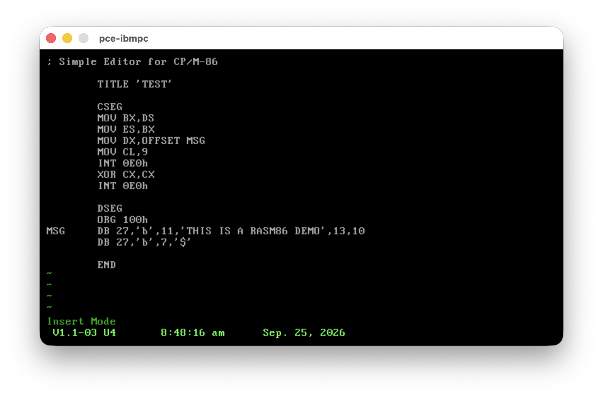
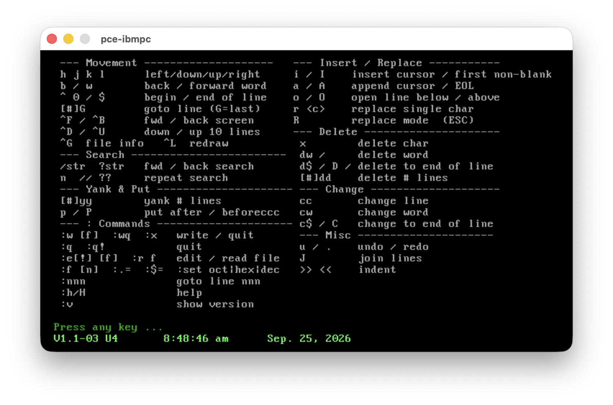

# Vi Editor for CP/M-86 and PC-DOS 1.1/MS-DOS 1.25

A port of **STevie** (ST Editor for VI Enthusiasts, by Tim Thompson) to
**CP/M-86** and **MS-DOS 1.1** on IBM-PC compatible hardware, compiled with
**Aztec C v4.2**.



---

## Why vi on CP/M-86 (and PC-DOS 1.1/MS-DOS 1.25)?

CP/M-86 ships with `ed` — a line-oriented editor inherited from DEC OSes.
While powerful for scripting, `ed` is notoriously difficult to use
interactively: you work blind, with no visible context of the file, no
cursor, and a command syntax that takes time to learn. DOS 1.1 doesn't even
have `ed` and predates ANSI.SYS, so it has essentially no interactive
screen editor at all.

There is no lightweight **screen-mode** editor for CP/M-86, and DOS 1.1's
bare BIOS environment makes porting one there even less common.
Most available options are either proprietary, CP/M-80 only, or require
a specific hardware terminal or heavier. This port of STevie fills that gap:
a familiar, full-screen vi experience that runs on standard IBM-PC
hardware, either through a VT-52/VT-100 terminal emulator on CP/M-86, or
directly against the PC BIOS on CP/M-86 or bare PC-DOS 1.1 — no terminal
emulator, no ANSI.SYS required.

---

## Features

- Full vi normal-mode command set (movement, insert, append, delete, yank,
  put, undo, search, `:` command line)
- Two keyboard input paths, selected at compile time:
  - **BDOS function 6** (`__CPM86__` + `__VTCMD__` builds) — a 64-byte ring
    buffer so fast typists don't lose keystrokes
  - **Direct PC BIOS** `INT 16h` (`__PCBIOS__` builds) — polled rather than
    blocking, so the cursor position can be re-asserted while waiting (see
    below)
- Composite / extended key support: arrow keys, Home, End, PgUp, PgDn
- Six build variants:

| Binary | Screen/keyboard | Build flags |
|--------|-----------------|-------------|
| `vicp52.cmd`    | VT-52 escape sequences (CP/M-86)         | `-D__CPM86__ -D__VTCMD__ -D__VT52__` |
| `vicp100.cmd`   | ANSI / VT-100 escape sequences (CP/M-86) | `-D__CPM86__ -D__VTCMD__ -D__VT100__` |
| `vicpbios.cmd`  | Direct PC BIOS, CP/M-86 `.cmd` binary    | `-D__CPM86__ -D__PCBIOS__` |
| `vid1bios.com`  | Direct PC BIOS, PC-DOS 1.1 compact `.com` | `-DVI_DOS1_COM` for `main.c`, DOS 1 BIOS objects |
| `vid1bios.exe`  | Direct PC BIOS, PC-DOS 1.1 small-model `.exe` | `-D__PCDOS__=11 -D__PCBIOS__` |
| `vid2bios.exe`  | Direct PC BIOS, PC-DOS 2.0 `.exe` binary | `-D__PCDOS__=20 -D__PCBIOS__` |

---

## Building

Requires the Aztec C 86 cross-development toolchain
(`aztec43_acc`) on the PATH, available from
[tsupplis/cpm86-crossdev](https://github.com/tsupplis/cpm86-crossdev),
plus `pcdev_cmdmod` for the CP/M EXTRA-group reservation,
and **cpmtools** (`cpmcp`, `cpmrm`, `cpmls`) for CP/M-86 disk image
management (DOS 1.1 images use `mtools`' `mcopy`/`mdir` instead).

```sh
# Build all six variants
make

# Build and package as a zip for distribution
make dist          # produces vi.zip

# Copy CP/M-86 binaries to a CP/M-86 test disk image
make cpmtest.img

# Copy the DOS binary to a PC-DOS 1.1 test disk image
make dostest.img

# Run under the PCE CP/M-86 emulator (or emu2 from cpm86-crossdev)
make cpm86test
```

The small CP/M test disk includes the VT52 and BIOS `.CMD` builds, the
DOS 1 `.COM` and the DOS 2 `.EXE` for DOS-compatible kernels. All six builds
are in the ZIP. The DOS test disk includes both DOS 1 formats and DOS 2;
DOS 1 is also installed there as `VI.COM` and `VI.EXE`. DOS chooses `.COM`
first when an extension is omitted: use `VI.EXE` or `VID1BIOS.EXE` explicitly
for the larger buffer.

Each build embeds the current `git describe` output (or `unknown` outside a
git checkout) as the version shown by the `:v` command; see `gitver.h`
(generated, not checked in) and `viversion()` in `window.c`.

### Complete correctness regression

Run `make test-regression` for one sequential regression batch. It force-rebuilds
all six production formats in a private build directory, then runs the existing host, native-runtime and
real-kernel correctness suites, including full-buffer/heap-headroom checks,
keyboard, editing/undo, EOF, display, navigation, I/O, save and yank coverage.
It requires the host sanitizer compiler, Aztec toolchain, `emu2`, PCE and the
kernel images used by the individual native tests below.

Every step runs once. Independent suites continue after failures so the batch
reports all results together; it does not modify source, retry failures, lower
budgets or run performance benchmarks. A suite that aborts early is a failure,
not evidence that its remaining cases passed.

The command prints the retained log directory and writes `summary.json` there
with the source revision/worktree state, each command, exit code, duration and
log path. Any failed step makes the overall command fail. To choose a new output
directory, run `python3 -B test/regression.py --output /path/to/new-directory`.
The rebuilt binaries remain in the log directory's `build/` subdirectory;
regression builds do not share or overwrite the working tree's objects or binaries.
This aggregates the existing probes; it is not an exhaustive interactive UI test.

Document redraws, status-line repainting and help hide the cursor while writing,
then restore it before waiting for input. Ordinary command-line Backspace erases
only the deleted cell; recovery from an overflow warning or control-character
input still repaints the command. Single-character insertion, append and deletion
(including insert-mode Backspace) use overlap-safe block moves instead of C
byte-copy loops. Tab refreshes once after its
four spaces rather than once per space. The regression checks these output and
copy counts as well as cursor visibility and final position.

Insert mode groups up to two already-waiting printable ASCII keystrokes into
one insertion and refresh. It never waits to fill a batch. Escape, Backspace,
Tab, newlines, literal input and extended keys remain separate; undo/repeat and
capacity limits are preserved. BIOS, VT and Concurrent CP/M input use a
nonblocking peek that retains the next key for normal processing.

### Host regression tests

Run `make test-editor-state` with a host C compiler (`cc`, or `CC_HOST`)
supporting AddressSanitizer and UndefinedBehaviorSanitizer. These tests cover
the 42,112-byte default/DOS 1 `.EXE` and 20,480-byte DOS 1 `.COM` buffers, including
exact-limit reads, oversized-read rollback, and full-buffer delete/undo.
They also cover
failed saves retaining the modified flag, failed `:r` leaving the buffer
unchanged, single-character replacements marking it modified, and repeat
searches retaining a valid pattern. They do not require an emulator.
They also check word deletion at EOF, bulk insertion, and `:r` insertion at
the middle/end of a buffer. Oversized imports and read/close failures cancel
the entire insertion and preserve the original buffer and modified state.
The same tests exercise buffer limits, recovery with Backspace/Escape,
undo/repeat at the insertion limit, and search wraparound at file boundaries.
Allocation-failure injection checks that filenames, search history and existing
text survive rejected commands. Ownership tracking checks repeated `:f`/`:e`
and aliased filename replacement for leaks and invalid frees. A table-driven
corpus feeds the real command parser: counts, cancellation, repeat and undo,
mixed indentation, empty/unterminated lines and full buffers. Specific cases
can be selected together, for example:
`python3 -B test/test_editor_state.py quality-commands quality-rejections`.

Aztec compiler intermediates share `TMPDIR/AZTEC/TEMP`. Run native compilations
serially and use a private `TMPDIR` when other Aztec builds may be active.

### Editing limits

The editor keeps its fixed 1024-byte undo, insertion and replay buffers.
`D`/`d$`, `dw`, `C`/`c$` and `cw` reject deletions over 1021 bytes before
changing the text or undo state. Insert sessions accept at most 1020 bytes
(slightly fewer for two-key commands or opened lines), reserving space for
an automatic EOF newline and replay terminators. Excess input produces a
warning; Backspace and Escape remain available.
Indent/outdent preflight the complete change and reuse the undo buffer as a
bitmap for up to 8,192 visited lines; larger changes are rejected before editing.
Unchanged outdents and capacity rejection preserve the previous undo record.
Indent/outdent and join undo restore the original bytes and modified flag,
including an originally full buffer, without allocating an additional snapshot.

Command lines hold 99 bytes after `:` (98 after `/` or `?`). If input
overflows, Enter cancels the command rather than executing a truncated name.
Backspace or Ctrl-U allows editing to resume, and Escape cancels. Status
messages truncate long filenames safely. Hex-byte entry (`Ctrl-X` in insert
mode) prompts for two digits without temporarily modifying the file.
Undo/repeat replays the recorded bytes without adding another EOF newline.

Yanked/deleted lines and both screen images share an external memory segment,
not the near C heap. The editing buffer holds 42,112 bytes, or 20,480 bytes
in the DOS 1 `.COM`. `FILELENG` is defined only in `main.c`; `VI_DOS1_COM`
selects the compact limit.
A full-buffer yank therefore no longer needs a second near-heap allocation.
All builds use small code/data compilation. DOS `.EXE` builds have separate
code and data segments; the DOS 1 `.COM` combines them in one 64 KiB window.
Both DOS 1 formats link the DOS 1.1 `d11` runtime, not the DOS 2
runtime. DOS 1 COM defines `VI_TINY` for all its C objects and omits the
full-screen help text. `H`, `:h` and `:help` report that help is omitted; see
the command reference below instead. Other formats retain full help.
Tiny also omits `:e`, `:e!`, `:r`, `:.r`, `:f` and save-as. It edits the
startup file only; quit and launch another instance to change files.
`:w`, `:wq`, `:x`, `:q` and `:q!` remain available. File arguments to save
commands are rejected rather than ignored, and failed saves still retain the
modified buffer. Full builds keep all existing file commands.
Excluded feature sections use `#ifndef VI_TINY`; dedicated COM objects prevent
tiny settings from leaking into full builds. Segment reservation is platform-specific:

- CP/M-86: `pcdev_cmdmod` adds a zero-image EXTRA group after linking,
  reserving 64 KiB at load time without adding 64 KiB to the executable.
  The DATA group requests a minimum of 60 KiB (61,440 bytes), up to 65,536 bytes,
  for near data, heap and stack; the editing buffer uses 42,112 bytes.
- DOS 1.x: use process-owned memory above the entire 64 KiB near data
  segment, after checking the PSP's memory ceiling; no DOS 2 calls. The
  external reservation is 32 KiB for `.COM`, 64 KiB for `.EXE`. DOS 1.1
  tests use 128 KiB RAM for `.COM` and 256 KiB for `.EXE`; the larger layout
  does not fit the 128 KiB configuration.
- DOS 2.x: allocate 4,096 paragraphs (64 KiB) with INT 21h/AH=48h and release
  them with AH=49h on exit.

The yank region matches the editing limit: 42,112 bytes, or 20,480 bytes in
the DOS 1 `.COM`. Two 2,000-byte screen slots
follow it. Rendering uses two 80-byte near row buffers instead of allocating
two full screens on the near heap. This removes 3,840 bytes of screen heap
allocations on CP/M-86 and 4,000 bytes on DOS, at the cost of the row buffers,
small bookkeeping, and additional code. Screens are limited to 80 columns
and 25 rows; unsupported dimensions fail explicitly.

Both editing limits remain aligned to 128-byte CP/M records.
This alignment lets a full binary buffer be saved and reopened without
record padding exceeding the editing limit. Line deletion scans the selected
range once and shifts the remaining tail once, including for files with
tens of thousands of blank lines.

Startup fails explicitly if the external segment is unavailable; there is no
disk or near-heap fallback. Failed yank/paste operations preserve text,
cursor and undo/repeat state; a failed yank also preserves the previous
yank. Paste preflights editing-buffer capacity and copies bytes in bulk,
including embedded NULs and an unterminated final line.
Bulk paste can fill the editing buffer exactly, including when undo
restores a full-file deletion. Character insertion still reserves a byte.

`make test-buffer-runtime` builds all six variants with a test
entry point and runs them under `emu2`, without scripted keyboard input. It checks
full-buffer loading, yank/delete/undo (including numeric replay), rejected
growth, and byte-exact saving/reopening for text, all-newline and binary files,
while holding an additional 4 KiB heap allocation in every variant.
It also checks parser-driven indent/outdent undo and full-buffer join undo.
The CP/M checks also verify the DATA header limits and repeat with allocation
capped at the 60 KiB minimum, holding an additional 2 KiB heap allocation.

`make test-yank-runtime` tests the real 8086 adapters under `emu2`, including
the full platform-specific yank capacity, both screen regions, their bounds
and independence, and rejection of missing/undersized CP/M EXTRA groups.
`make test-yank-pce` additionally boots private image copies for DOS 1.1,
DOS Plus (both CMD and DOS EXE), Concurrent CP/M and Concurrent DOS.
It requires PCE, mtools/cpmtools and the same local kernel fixtures as the
save-runtime tests.

`make test-dos1-pce` runs both full DOS 1 editor probes on private DOS 1.1
boot images: 20,480 bytes on 128 KiB RAM for `.COM`, 42,112 bytes on 256 KiB
RAM for `.EXE`. It verifies binary read/yank/delete/undo/save/reopen cycles
and rejected oversized input while holding an additional 4 KiB heap
allocation in each format, then compares the saved bytes.

`make test-scroll` checks scrolling, paging, status-row protection, screen
clearing/diffing, and 500 frame/Botchar comparisons against the previous renderer
under host sanitizers.

### Display output

The renderer groups adjacent changed cells into row-bounded output runs.
BIOS builds use the original PC BIOS character-only service (INT 10h/AH=0Ah),
batching repeated characters with its repeat count. This preserves existing
cell attributes and avoids teletype's per-character cursor updates. The BIOS
data-area page-zero cursor is set before each BIOS write, so background console
cursor changes do not redirect subsequent writes; the hardware cursor is
updated at the end of each run. There are no direct video-memory writes.
Status messages, control characters and other single-character callers retain
the original output path. VT52/VT100 use one descriptor-level `write()` per
changed run or cursor sequence, avoiding per-character stdio overhead.
Pending stdio output is flushed first to preserve ordering. The existing
CP/M console driver still handles every byte: no direct XIOS calls, new BDOS
services, string terminators or production delays are introduced. Flush and
short/failed-write errors are reported explicitly.

`make test-display-pce` compares a frozen old diff/output path with the new
path on private DOS 1.1 and DOS Plus images, using a standard-speed 8088
configuration (`speed = 1`). It checks physical characters, attributes, cursor
position, status-row protection and simulated background cursor changes.
Full repaint, row-shifted repaint, single-cell edits and long runs are measured
with BIOS clock ticks. This deliberately runs slower than accelerated tests.
`make test-display-compat` runs the functional checks at accelerated speed,
including the Concurrent DOS 4.1 BIOS build.

Measured bulk-output totals (four full repaints, four row-shifted repaints and
sixteen long-row updates; smaller is better):

| Kernel/build | Video | Old ticks | New ticks | Speedup |
|---|---|---:|---:|---:|
| DOS 1.1 `.COM` | CGA | 435 | 128 | 3.40x |
| DOS 1.1 `.COM` | MDA | 359 | 111 | 3.23x |
| DOS 1.1 `.EXE` | CGA | 437 | 127 | 3.44x |
| DOS 1.1 `.EXE` | MDA | 359 | 111 | 3.23x |
| DOS Plus CP/M BIOS `.CMD` | CGA | 528 | 138 | 3.83x |
| DOS Plus DOS 2 `.EXE` | CGA | 539 | 141 | 3.82x |

These are diff/output benchmarks with prebuilt desired frames, not whole-editor
or disk-I/O speedups. Timed runs include invalidating the old screen image and
exclude the interrupt-counting/injection hook. Single-cell timings were
essentially unchanged. VT measurements are separate from these BIOS results.

`make test-vt-output` compiles both complete VT backends on the host and checks
all 1,920 cursor positions, all byte values, buffered-output ordering, and
flush/write/short-write failure handling. `make test-vt-pce` compares frozen
character-at-a-time output with the new VT52 path on DOS Plus and Concurrent
DOS 4.1. It checks identical BDOS byte streams, physical cells/attributes and
hardware cursor positions. The functional checks allow two timer ticks for
XIOS to commit asynchronous cursor updates; this wait exists only in the probe.
Use `python3 -B test/test_vt_pce.py --compat-only` to skip performance timing.

The short DOS Plus/CGA 8088 measurement (`speed = 1`) took **253 -> 174 ticks**
for two full repaints, two row-shifted repaints and eight long-row updates:
**1.45x faster**, or about **31% less time**. Sixteen single-cell updates took
37 -> 36 ticks, effectively unchanged at this resolution. BDOS byte counts
remain identical; the improvement removes library overhead, not terminal
traffic. No native VT100/ANSI timing result is claimed, and these are not
whole-editor speedups.

### Short performance baseline

`make test-perf-pce` runs one bounded standard-speed 8088/DOS 1/CGA profile:
load/save, middle import, beginning edit primitives, scrolling, long-line cursor
and failed search. It records coarse ticks, fixture hashes, all six production
image sizes and a held-spare heap budget. No display timing sweep is rerun.
See [performance.md](docs/performance.md) for fixtures, scope, recorded values
and JSON output. Batched imports reduce the middle-import sample from 159 to
6 ticks (roughly 26x faster for that operation), without extra heap or scratch
buffers. Chunk-boundary, capacity and rollback checks pass on host and all three
native runtimes.

`make test-characters` checks all byte widths, octal/hex/decimal display strings
and mode switches on host and all three native runtimes. The compact display
cache saves 498 resident DATA bytes and about 1.5 KiB per executable, without
formatting numbers during redraw. See [the size/timing comparison](docs/performance.md#s1-compact-cached-display-text).

`make test-capacity-runtime` checks unsigned byte spans, capacity rejection,
EOF reservation and large tail copies at 32,000, 32,767, 32,768, 40,000 and
40,064 bytes
under host sanitizers and all three native runtimes. Capacity checks now
subtract converted near addresses rather than signed 16-bit pointer differences.
Read/nonprintable counts and byte-position/save reports also use unsigned
byte accounting; failed imports restore the original tail using an unsigned
span. The save backend already uses `long` for physical output sizes, including
CRLF expansion.

`make test-io-runtime` checks reads at 32,767, 32,768 and 40,000 bytes,
read/close/overflow rollback, restoration of tails longer than 32 KiB,
and 40,000-byte binary and 80,000-byte CRLF-expanded text saves under host
sanitizers and all three native runtimes.

Yank/paste and deletion byte lengths also use unsigned accounting. Paste
checks available space before adding separator bytes, and oversized word/EOL
deletions cannot wrap past the undo-size check. String insertion counts bytes
directly because the native runtime's `strlen` stops below 32 KiB.

`make test-yank-lengths` checks full-capacity binary yank/delete/paste roundtrips,
separator/capacity rejection, failed-yank preservation, partial-load rollback
over a large tail, and 40,000-byte insertion/deletion boundaries under host
sanitizers and all three native runtimes. These tests use the production
42,112-byte yank regions on all three native runtimes.

Search bounds use unsigned byte spans. Command counts, linewise operations
and their replay strings support counts through 65,535; larger numeric prefixes
and `:N` addresses are rejected explicitly rather than wrapping. Line reports,
temporary screen-row counts and virtual columns use wider arithmetic.
Vertical movement uses the renderer's displayed widths, including expanded
binary characters. `G` also reaches an unterminated final line.

`make test-navigation-runtime` checks search wrapping/overlap, 32,767/32,768/
40,000/40,064-byte and line boundaries, virtual columns above 65,535, and numeric
prefix parsing on the host and all three native runtimes. Host editor tests
add oversized-command cancellation, unsigned count replay and undo checks;
the six production probes also verify count rejection and 65,535-count
delete/toggle operations.

It also compares cursor geometry and both search directions against frozen
references across short binary fixtures and every cursor/EOF position.
`make test-navigation-perf-pce` runs one short standard-speed 8088 comparison:
the measured long-line cursor case is about 1.4x faster; three failed-search
patterns are 2-2.5x faster, without a cache or skip table. See
[P4 measurements and scope](docs/performance.md#p4-cursor-and-search-scanning).

Production editing and yank limits are 42,112 bytes, or 20,480 bytes in
the DOS 1 `.COM`.

Searches wrap within the file only, handle overlapping matches, and start
after/before the cursor in the selected direction before wrapping.

## Command Reference



### Movement

| Command | Action |
|---------|--------|
| `h` `j` `k` `l` | Left / down / up / right |
| `b` | Back one word |
| `w` | Forward one word |
| `^` or `0` | Beginning of line |
| `$` | End of line |
| `[#]G` | Go to line `#` (no count = last line) |
| `^F` | Forward one screen |
| `^B` | Back one screen |
| `^D` | Down 10 lines |
| `^U` | Up 10 lines |
| `^G` | Show file info |
| `^L` | Redraw screen |
| `m` | Set the single buffer-local mark at the cursor |
| `'` | Return to the exact marked character, if defined |

Neither mark command reads a name or changes undo/repeat. The mark follows its
original character through insertions and deletions before it. Deleting that
character invalidates the mark, and undo does not restore an invalidated mark.
Replacing a character in place retains it. Opening another file clears it,
including a failed read after `:e!`; changing only the filename retains it.
Failed imports and pastes leave it unchanged. An undefined mark reports an
error without moving the cursor. There is no jump toggle or mark operator motion.
An off-screen mark is revealed at the top of the viewport rather than scrolling
through every intervening row.

### Insert / Replace

| Command | Action |
|---------|--------|
| `i` | Insert before cursor |
| `a` | Append after cursor |
| `o` | Open new line below, enter insert mode |
| `O` | Open new line above, enter insert mode |
| `r <c>` | Replace single character under cursor with `<c>` |
| `R` | Enter replace mode (overwrite); `ESC` to exit |
| `^V <c>` | Insert next character literally (e.g. `^V Tab` inserts a real tab) |
| `ESC` | Exit insert or replace mode, return to normal |

### Delete

| Command | Action |
|---------|--------|
| `x` | Delete character under cursor |
| `[#]dd` | Delete `#` lines (default 1) |
| `dw` | Delete word |
| `D` or `d$` | Delete to end of line |

### Change

| Command | Action |
|---------|--------|
| `cc` | Change entire line (delete line, enter insert) |
| `cw` | Change word |
| `C` or `c$` | Change to end of line |

### Yank & Put

| Command | Action |
|---------|--------|
| `[#]yy` | Yank `#` lines into buffer (default 1) |
| `p` | Put yanked/deleted lines after current line |
| `P` | Put yanked/deleted lines before current line |

### Miscellaneous

| Command | Action |
|---------|--------|
| `u` | Undo last change |
| `.` | Redo last insert or delete |
| `J` | Join current line with next |
| `[#]~` | Toggle case of `#` characters from cursor (default 1) |
| `[#]>>` | Indent `#` lines right by one tab (default 1) |
| `[#]<<` | Indent `#` lines left by one tab (default 1) |
| `H` | Show built-in help screen |

### Search

| Command | Action |
|---------|--------|
| `/str` | Search forward for `str` |
| `?str` | Search backward for `str` |
| `n` | Repeat last search |
| `//` or `??` | Repeat last search (command-line form) |

### `:` Command line

| Command | Action |
|---------|--------|
| `:w` | Write file |
| `:w <file>` | Write to `<file>` |
| `:wq` or `:x` | Write and quit |
| `:q` | Quit (refuses if unsaved changes) |
| `:q!` | Quit unconditionally |
| `:e <file>` | Edit `<file>` |
| `:e!` | Re-read current file, discarding changes |
| `:r <file>` | Read `<file>` and insert after current line |
| `:f` | Show current filename and size |
| `:f <name>` | Rename current file (in-editor) |
| `:.=` | Show current line number and character offset |
| `:$=` | Show total number of lines |
| `:set oct` | Display non-printable characters in octal |
| `:set hex` | Display non-printable characters in hex |
| `:set dec` | Display non-printable characters in decimal |
| `:v` | Show the build variant and version (git describe) |
| `:h` or `:help` | Show built-in help screen |
| `:<N>` | Go to line `N` (clamps to last line if `N` exceeds the file) |

---

## Terminal key sequences

The arrow keys, Home, PgUp, PgDn and End send different byte sequences
depending on the terminal type.

### VT-52 (`vicp52.cmd`)

VT-52 cursor keys send a two-byte sequence: `ESC` followed by a single letter.

| Key | Sequence | vi action |
|-----|----------|-----------|
| ↑ Up    | `ESC A` | `k` — move up one line |
| ↓ Down  | `ESC B` | `j` — move down one line |
| → Right | `ESC C` | `l` — move right one char |
| ← Left  | `ESC D` | `h` — move left one char |
| Home    | `ESC H` | `0` — beginning of line |
| PgUp    | `ESC I` | `^B` — back one screen |
| End     | `^Z` (0x1A) | `$` — end of line |
| PgDn    | `^J` (0x0A) | `^F` — forward one screen |

### VT-100 / ANSI (`vicp100.cmd`)

VT-100 cursor keys send a three-byte sequence: `ESC [` followed by a letter.

| Key | Sequence | vi action |
|-----|----------|-----------|
| ↑ Up    | `ESC [ A` | `k` — move up one line |
| ↓ Down  | `ESC [ B` | `j` — move down one line |
| → Right | `ESC [ C` | `l` — move right one char |
| ← Left  | `ESC [ D` | `h` — move left one char |
| Home    | `ESC [ H` | `0` — beginning of line |
| PgUp    | `ESC [ I` | `^B` — back one screen |
| End     | `^Z` (0x1A) | `$` — end of line |
| PgDn    | `^J` (0x0A) | `^F` — forward one screen |

> End and PgDn arrive as bare control codes with no ESC prefix on both
> terminal types, as sent by the IBM-PC CP/M-86 BDOS keyboard handler.

### PC BIOS (`vicpbios.cmd`, `vid1bios.com`, `vid1bios.exe`, `vid2bios.exe`)

On legacy CP/M and DOS, `getch()` reads `INT 16h` scan codes
directly and synthesizes the same lone `ESC` + letter sequences as VT-52,
so these builds share escape-parsing code in `edit.c`. Concurrent CP/M instead
uses the BDOS keyboard adapter described below.

| Key | BIOS scan code | Synthesized sequence | vi action |
|-----|-----------------|----------------------|-----------|
| ↑ Up    | `0x48` | `ESC A` | `k` — move up one line |
| ↓ Down  | `0x50` | `ESC B` | `j` — move down one line |
| → Right | `0x4D` | `ESC C` | `l` — move right one char |
| ← Left  | `0x4B` | `ESC D` | `h` — move left one char |
| Home    | `0x47` | `ESC H` | `0` — beginning of line |
| PgUp    | `0x49` | `ESC I` | `^B` — back one screen |
| PgDn    | `0x51` | `^J` (0x0A) | `^F` — forward one screen |
| End     | `0x4F` | `^Z` (0x1A) | `$` — end of line |
| Insert  | `0x52` | `ESC L` | (not yet used in vi) |
| Delete  | `0x53` | `\x7F` | (not yet used in vi) |

---

## Requirements

- **Aztec C 86 v4.3** compiler driver (`aztec43_acc`) —
  from [tsupplis/cpm86-crossdev](https://github.com/tsupplis/cpm86-crossdev)
- **cpmtools** (`cpmcp`, `cpmrm`, `cpmls`) to manage CP/M-86 disk images
- **mtools** (`mcopy`, `mdir`) to manage the DOS 1.1 disk image (`dostest.img`)
- **zip** for `make dist`
- **git** (optional) — used to embed a version string via `:v`; falls back
  to `unknown` if not run from a git checkout
- **CP/M-86 1.1**, from [tsupplis/cpm86-kernel](https://github.com/tsupplis/cpm86-kernel),
  for the `vicp52.cmd`/`vicp100.cmd`/`vicpbios.cmd` binaries
- **PC-DOS 1.1**, from [tsupplis/pcdos11-hacking](https://github.com/tsupplis/pcdos11-hacking),
  for the `vid1bios.com` and `vid1bios.exe` binaries
- An emulator for testing — optional; two suitable options:
  - **PCE** CP/M-86 emulator (`cpm86`), for the CP/M-86 binaries
  - **emu2** — runs both CP/M-86 `.cmd` and DOS `.com` binaries locally,
    bundled with [tsupplis/cpm86-crossdev](https://github.com/tsupplis/cpm86-crossdev)
    (from [johnsonjh/emu2-cpm86](https://github.com/johnsonjh/emu2-cpm86))

---

## OS compatibility matrix

| Binary | CP/M-86 1.1 |  CCP/M-86 3.1 | CDOS 3.2 | CDOS 4.1 | DOS Plus 1.2 | PC-DOS 1.1 | DOS ≥ 2.0 | Emu2 |
|--------|-------------|-----------|-------------|---------------------|--------------|------------|-----------|------|
| `vicpbios.cmd`             | ✅ | ✅ | ✅ | ✅ | ✅ | — | — | ✅ |
| `vicp52.cmd`               | ✅ | ✅ | ✅ | ✅ | ✅ | — | — | ✅(1) |
| `vicp100.cmd`              | ✅ | ✅ | ✅ | ✅ | ✅ | — | — | ✅(1) |
| `vid1bios.com`             | — | — | ✅ | ✅ | ✅ | ✅ | ✅ | ✅(2)|
| `vid1bios.exe`             | — | — | ? | ? | ? | ✅ | ? | ✅(2)|
| `vid2bios.exe`             | — | — | — | ✅  | ✅ | — | ✅ | ✅(2) |

1. keyboard navigation keys need to be configured
2. 25 lines terminal needed

The DOS 1 `.COM` is freshly verified on PC-DOS 1.1 with 128 KiB RAM;
its other kernel entries retain earlier `.COM` compatibility results.
The DOS 1 `.EXE` is verified on PC-DOS 1.1 with 256 KiB RAM and under
`emu2`. Other DOS-compatible kernels marked `?` have not yet been rechecked
with the `.EXE` build.

## Concurrent CP/M keyboard

On concurrent BDOS >= 3.0, all CP/M builds use BDOS input for navigation keys
and restore normal function-key expansion on exit. Legacy CP/M and DOS input
paths are preserved. VI includes its own small OS helpers and needs no utility
library. The BIOS build still uses BIOS display calls; prefer VT52 for native
Concurrent CP/M consoles.

## Viewport scrolling

Up/Down scroll only as far as needed to keep the cursor visible. Page and
half-page movement use the document area, reserving the last row for status
and commands, including with wrapped lines and at EOF.

Run `make test-keys test-scroll` for keyboard, OS-gating and viewport checks.
On DOS Plus, CP/M builds reset the text mode on close to restore the XIOS
scrolling origin and cursor state.

--

## Companion projects

| Project | Description |
|---------|-------------|
| [cpm86-kernel](https://github.com/tsupplis/cpm86-kernel)     | CP/M-86 1.1 distribution rebuilt from patched and reconstituted sources |
| [ccpm86-kernel](https://github.com/tsupplis/ccpm86-kernel)         | CCP/M-86 3.1 distribution rebuilt from patched and reconstituted sources |
| [cdos41-kernel](https://github.com/tsupplis/cdos41-kernel)         | Concurrent DOS 4.1 distribution rebuilt from patched and reconstituted sources |
| [cpm86-crossdev](https://github.com/tsupplis/cpm86-crossdev) | Unix CP/M-86 cross development project (compilers, emulation and tools) |
| [cpm86-hacking](https://github.com/tsupplis/cpm86-hacking)   | CP/M-86 miscellaneous tools and PCE emulator helpers |
| [cpm86-cmdtools](https://github.com/tsupplis/cpm86-cmdtools) | CP/M-86 `.cmd` file manipulation tools |
| [cpm86-ports](https://github.com/tsupplis/cpm86-ports)       | CP/M-86 application ports in C and assembler |
| [cpm86-vi](https://github.com/tsupplis/cpm86-vi)             | STevie vi port for CP/M-86 and PC-DOS |
| [cpm86-msbasic](https://github.com/tsupplis/cpm86-msbasic)   | A recreaction of msbasic-86 for CP/M-86 and PC-DOS 1.1 from gwbasic sources |
| [cpm86-menu](https://github.com/tsupplis/cpm86-menu)   | A submit replacement and a menu system for submit orchestration for CP/M-86 1.1 |
| [cpm86-make](https://github.com/tsupplis/cpm86-make)   | A simple submit based make tool for CP/M-86 |
| [pcdos11-hacking](https://github.com/tsupplis/pcdos11-hacking) | PC-DOS 1.1 distribution, tools and notes |

--

## License

The whole repository is as public domain. [License](LICENSE.md) unless specified otherwise in a subdirectory.


## Saving files

The command-line and save objects are built separately for DOS and CP/M.
All existing-file saves use a temporary file and backup, on DOS and CP/M.
Writes, flushing, closing, and exact-length metadata updates complete before
VI renames the original. A failure before installation leaves the original
bytes intact. Failed installation attempts restore the original name; if
restoration also fails, both recovery files remain and the diagnostic reports
their names. A failed save leaves the editor marked modified.

DOS 1.1 and DOS 2 use the Aztec runtime's `ftruncate` on the temporary file,
counting physical bytes including inserted CRs. DOS text does not need a
trailing Ctrl-Z. Binary reads preserve embedded 1Ah.

CP/M exact-length policy uses the complete AX returned by BDOS function 12:

| Identity | Length policy |
| --- | --- |
| 8086 Concurrent family 4 or 6, BDOS >= 3.1 | Used-byte LRBC metadata |
| 1041h: DOS Plus | Used-byte LRBC metadata |
| CP/M-86 Plus, classic CP/M-86 and other identities | 128-byte records |

The version threshold applies only to Concurrent families, including networking.
Fresh replacement files need no record truncation. Text output has a Ctrl-Z
terminator and deliberate record padding; binary padding is zero. Concurrent
BDOS 3.1+ and DOS Plus binary reads honor exact LRBC metadata.

Replacement files (`VI000000.TMP` onward) and backup names (`VI000000.BAK`
onward) are created exclusively beside the target (same DOS directory or
CP/M drive/user area). Saving needs enough free space for the complete new
file while the original still exists. Original read-only files are rejected.
CP/M read-only/system/archive attributes are carried to the replacement;
replacement does not promise preservation of timestamps or other extended
file metadata. No failed open is followed by a destructive create. The original
CP/M user area is restored on every returning path. The rename sequence is
recoverable, but is not an atomic transaction across a power loss.

Validation:

```
make test-save          # host files, mocked BDOS, injected I/O/rename failures
make test-save-runtime  # DOS 2 and classic CP/M probes under emu2; builds the DOS 1.1 probe
make test-save-pce      # private DOS 1.1, DOS Plus, CCP/M 3.1 and CDOS 4.1 images
```

The save runtime test uses `aztec43_acc` and `emu2` from `PATH`. Stock `emu2`
does not model the DOS 1.1 truncate behavior, so the DOS 1.1 probe is built for
the PCE test but not run under `emu2`. PCE testing needs the DOS 1.1 checkout at
`~/Projects/DOS/pcdos11-hacking` (override `DOS11_SOURCE`) and this checkout's
DOS Plus, CCP/M and CDOS image/ROM files, plus the sibling ref checkout's
`diskdefs` and `scripts/cpm86twist`. Original images are never modified.
The LRBC kernels must return exact lengths in the probe; record-rounded fallback
cannot pass. CP/M-86 Plus and network-family selection have mocked coverage only.

Reference: Digital Research's CP/M-86 Plus Programmer's Guide, functions 12,
30 and 99, and the supplied DOS Plus 1.2 kernel exercised under PCE.
