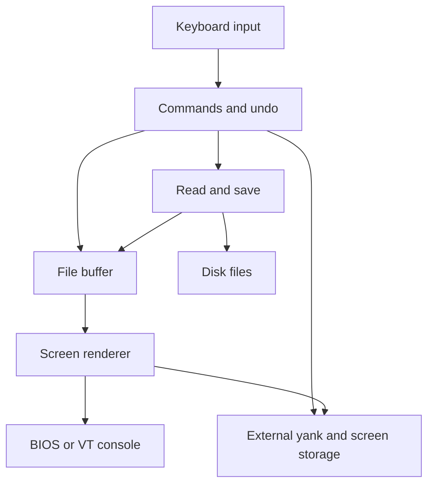

# STevie/vi for CP/M-86 and PC-DOS - Design Notes

This describes the current implementation, built with Aztec C86 v4.10d.
Open work and acceptance criteria live in [todo.md](../todo.md); supported
kernel combinations and user commands are in [README.md](../README.md).

## Architecture

The editor is single-file and single-buffer. File bytes occupy one contiguous
near-heap block, without a gap buffer or piece table. Navigation operates on
pointers into that block. The renderer builds a desired frame, compares it with
the last displayed frame and emits only changed cells. Yanked bytes and both
screen images occupy a separate segment, accessed through checked copy APIs.

Platform boundaries include console input/output, file saving and exact-length
metadata, OS detection/restoration, and external-memory adapters. Editing,
command parsing, navigation and screen diffing share the same C implementation.

### Component model

Simple component overview; source-file responsibilities are listed below.

## Six build variants

| Binary | Console | Editing/yank capacity | Runtime |
|---|---|---:|---|
| `vicp52.cmd` | CP/M VT52 | 38,016 bytes | `c86` |
| `vicp100.cmd` | CP/M VT100/ANSI | 38,016 bytes | `c86` |
| `vicpbios.cmd` | CP/M PC BIOS | 38,016 bytes | `c86` |
| `vid1bios.com` | DOS 1 PC BIOS | 20,480 bytes | `d11` |
| `vid1bios.exe` | DOS 1 PC BIOS | 38,016 bytes | `d11` |
| `vid2bios.exe` | DOS 2 PC BIOS | 38,016 bytes | `c` |

`edit.c` and `window.c` have terminal/OS-specific objects; the DOS 1 formats
share their BIOS objects. `cmdline.c`, `save.c` and `keyboard.c` have CP/M/DOS
objects. Other C objects are shared except `main.c`, which has a separate
`VI_DOS1_COM` object selecting its private `FILELENG`. The external adapter
reports the matching yank capacity at runtime.

`__CPM86__` selects CP/M behavior; `__PCDOS__` identifies DOS 11/20.
`__VTCMD__` selects escape-code output with `__VT52__` or `__VT100__`;
`__PCBIOS__` selects BIOS output and legacy BIOS keyboard input.
Concurrent CP/M keyboard handling overrides that legacy input choice.

Use serial Aztec compilations (`make -j1`): compiler intermediates share
`TMPDIR/AZTEC/TEMP`. Use a private `TMPDIR` when other builds may be active.
Native probes build in private directories; never run two Aztec builds sharing
the same temporary directory concurrently.

## Memory layout

All builds use small code/data compilation. DOS EXEs have separate code/data
segments; DOS 1 COM shares a 64 KiB window for code, data, heap and stack.
The reduced COM capacity deliberately leaves additional headroom.

| Platform | External memory | Source/reservation |
|---|---:|---|
| CP/M | 64 KiB | Zero-image EXTRA group; no 64 KiB payload in the CMD |
| DOS 1 COM | 32 KiB | Process-owned memory above the near window |
| DOS 1 EXE | 64 KiB | Process-owned memory above the near-data window |
| DOS 2 EXE | 64 KiB | INT 21h/AH=48h, released with AH=49h |

DOS 1 adapters check the PSP memory ceiling and never use DOS 2 allocation
services. CP/M DATA requests 61,440 bytes minimum, up to 65,536 bytes.
Real DOS 1 tests use 128 KiB RAM for COM and 256 KiB for EXE.

The yank region occupies the beginning of the external segment, followed by two
fixed 2,000-byte screen slots. Only configured rows/columns are transferred.
Maximum dimensions are 25x80; CP/M uses 24 rows, DOS 25. The final logical row
belongs to status/commands, not document rendering. Two 80-byte near buffers
replace near-heap screen images.

Core globals are defined in `main.c` and declared in `stevie.h`, using `vi_`
names. `chars[]` lives in `hexchars.c`. Search history, yank metadata, console
state and literal-undo metadata are private to their modules.

## Editing and ownership invariants

- `vi_file_mem <= vi_file_end <= vi_file_max`; `vi_file_end` is one past the
  logical bytes, not a string terminator. Binary data can contain any byte.
  Cursor and viewport pointers refer to this allocation; empty-file cursor is
  `vi_file_mem`. File replacement resets undo before reading another file.
- Large lengths use unsigned byte counts. `vi_byte_span()` subtracts converted
  near addresses rather than a signed 16-bit pointer difference. Counts use
  `unsigned long`: `VI_COUNT_MAX + 1` is an overflow sentinel rejected before
  narrowing or executing a command.
- Aztec's native `strlen()` does not cover the whole unsigned 16-bit range.
  Large insertion lengths are counted explicitly. Small command/filename
  strings may use the runtime string functions.
- Single-character insertion reserves one spare byte. Bulk paste can fill the
  editing allocation exactly. Preflight capacity and undo/replay bounds before
  changing text; do not turn rejected operations into partial edits.
- `strsave()` diagnoses allocation failure and returns NULL. Callers must
  retain their previous state on failure. Optional message caching must not
  recurse into allocation-error reporting.
- The current filename is NULL or owned heap storage. `vi_set_filename()`
  copies before freeing, including interior aliases; an unchanged pointer needs
  no allocation. Failed replacement preserves filename, buffer and undo.
- A new search copies the pattern before releasing the old one; failed
  allocation preserves both pattern and direction. Repeat search allocates
  nothing.

### Undo and replay

Undo is single-level, usually replaying inverse commands through the real
interpreter. The four fixed 1,024-byte buffers hold undo, repeat, insertion and
replacement bytes. `stuffin()` checks pending-plus-new replay length before
changing the queue. `addtobuff()` takes six integer character slots, padded or
terminated with zero.

`D`/`d$`, `dw`, `C`/`c$` and `cw` reject deletions exceeding 1,021 bytes.
Insert sessions reserve replay terminators and a possible EOF newline, normally
accepting at most 1,020 bytes (less for some command prefixes).
Replay must not invent an additional EOF newline.

Indent/outdent and join use literal single-byte undo rather than inverse
commands. The existing undo buffer becomes a bitmap selecting changed lines;
at most 8,192 visited lines are representable. Preflight rejects larger changes
or insufficient capacity before mutation. No-op outdents and EOF joins retain
the previous undo record. Undo can restore an originally full buffer without
the spare-byte restriction used by interactive insertion. These literal edits
swap the modified-state snapshot on undo; no extra file snapshot is allocated.
`resetundo()` invalidates replay/literal records and stale Replace metadata.

## Data movement and file I/O

`inschar()`/`appchar()`/`delchar()` shift the tail once per byte.
`insstr()` moves the tail once per string; `delline()` once per deleted range.
`putline()` moves the tail once, loads external yank bytes, and rolls the tail
back if loading fails. Paste separates terminated/unterminated lines as needed.

`readfile()` stages up to 128 filtered bytes in its existing status buffer,
then moves the existing tail once and copies the chunk into the gap.
Middle `:r` costs O(import bytes + ceil(import bytes / 128) x existing tail
bytes). Loading an empty buffer has no existing tail to move. No extra heap
or scratch buffer is allocated.
Read/close/capacity errors remove all bytes inserted by that read and restore
the original tail and logical end. Text reads discard CR and stop at Ctrl-Z;
binary reads use exact length metadata where supported.

`:e!` deliberately clears the old text after filename allocation succeeds.
A subsequent read failure does not restore that old file. This differs from
`:r`'s all-or-nothing insertion contract.

`vi_save_file()` returns an error string or NULL. DOS flushes and then uses the
runtime's `ftruncate()`, counting physical CRLF expansion. CP/M pads records
and uses identity-gated truncation/LRBC metadata; classic/unknown identities
use temporary-file replacement. Empty binary saves also use replacement.
Errors retain the modified flag and report retained recovery filenames where
applicable. In-place saving is not crash-atomic.
See the [save policy](../README.md#saving-files) for exact identities.

## Rendering and console rules

`filetonext()` expands bytes through the 256-entry `chars[]` table.
Octal/hex/decimal formatting changes table strings, not the underlying file.
Tabs and other expanded bytes can cross display rows. Delayed wrapping avoids
consuming an extra row for a newline immediately after a full row.
`cursupdate()` scrolls only far enough to reveal the final cursor position;
it scans the visible prefix and the logical line prefix for column accounting.

`nexttoscreen()` loads external rows and groups adjacent changed printable
cells into runs. Runs are positive-length, stay within one row and exclude
C0 controls. Control bytes and leading colored `~` use the legacy single-byte
path. Desired/real screen rows are updated consistently; the status row is
never part of the document diff.

BIOS runs use INT 10h/AH=0Ah, coalescing repeated characters with CX and preserving
cell attributes. Set the page-zero BIOS cursor word at `0040:0050` before
every BIOS write; background console activity can otherwise redirect output.
The hardware cursor is updated once per run. No direct video-memory writes are
used; the BIOS retains CGA synchronization. UI/single-byte output and idle
cursor recovery retain explicit cursor positioning.

VT runs and cursor sequences use descriptor-level writes, bypassing
per-character stdio overhead but not the CP/M console driver. Flush pending
stdio bytes first to preserve ordering. Do not substitute dollar-terminated
BDOS string output: dollar signs/high-bit bytes must survive unchanged.
Flush/short-write/write errors diagnose failure and restore keyboard state.
Only native tests wait for asynchronous XIOS hardware-cursor updates;
production adds no delay.

Aztec inline assembly uses suffixed symbols (`cur_row_`, etc.) and stack
arguments at `[bp+4]`/`[bp+6]`. A local `int dummy;` forces the required BP
frame. Changing C statics or signatures requires checking their included
assembly, not just C callers.

## Modules and platform boundaries

| Module | Responsibility |
|---|---|
| `main.c` | Startup/globals, file allocation/read, screen construction/diff, replay queue |
| `edit.c` | Real keyboard/state parser, insertion/replacement, cursor/viewport movement |
| `normal.c` | Normal commands, indentation/join literal undo, undo reset |
| `cmdline.c` | `:`/search line parsing, bounded command input, optional message cache |
| `linefunc.c` | Line/column helpers, checked string ownership, search history/scan |
| `misccmds.c` | Editing primitives, line yank/paste, file information |
| `hexchars.c` / `help.c` | Character representations and built-in help |
| `save.c` / `save.h` | OS-specific save, truncation/replacement, exact-length query |
| `window.c` / included assembly | VT/BIOS output and initialization/restoration |
| `keyboard.c` / `keyos.c` / `os.asm` | Concurrent console keyboard mapping, OS identity/restoration |
| `yankmem.c` / `yankmem.h` | Checked external yank/screen APIs |
| `yankcopy.asm` / `yankcp.asm` / `yankd*.asm` | Segment copies and platform reservation/release |
| `stevie.h` / `keyboard.h` / `keyos.h` | Shared types, state and public prototypes |

Concurrent BDOS consoles use `vi_key_read()` instead of BIOS keyboard input,
temporarily disabling function-key expansion and restoring it on exit.
Legacy CP/M/DOS input paths remain. DOS Plus text-mode restoration is gated by
its OS identity and never invoked on concurrent systems.

## Verification and remaining costs

Host sanitizer tests exercise production functions and the real command parser;
some harnesses still extract function bodies (M2). Standard string functions
come from `<string.h>`; no local `strchr()` override remains.

Native tests cover all six variants, full-capacity text/newline/binary files,
byte-exact save/reopen, external storage bounds and held-spare heap budgets.
The current verified budgets are 4 KiB in normal profiles and 2 KiB at CP/M's
minimum DATA allocation; these are guaranteed test allocations, not measured
maximum free heap. Real DOS 1 boots additionally exercise COM/EXE on 128/256 KiB.

Display tests compare frozen/current renderers, physical cells/attributes and
cursor behavior, including simulated BIOS cursor disturbances and VT byte
streams. Existing display timing results are in the
[README](../README.md#display-output); do not rerun all display profiles merely
to measure unrelated CPU work.

Remaining candidates are repeated cursor/line rescans and naive
O(n x pattern length) search (P4), disk buffering (P5), and
character-table compaction (S1). String insertion, line deletion and paste
use bulk tail moves; file imports use bounded chunks. None requires committing to
a gap-buffer rewrite. Measure separately before trading memory for speed.
